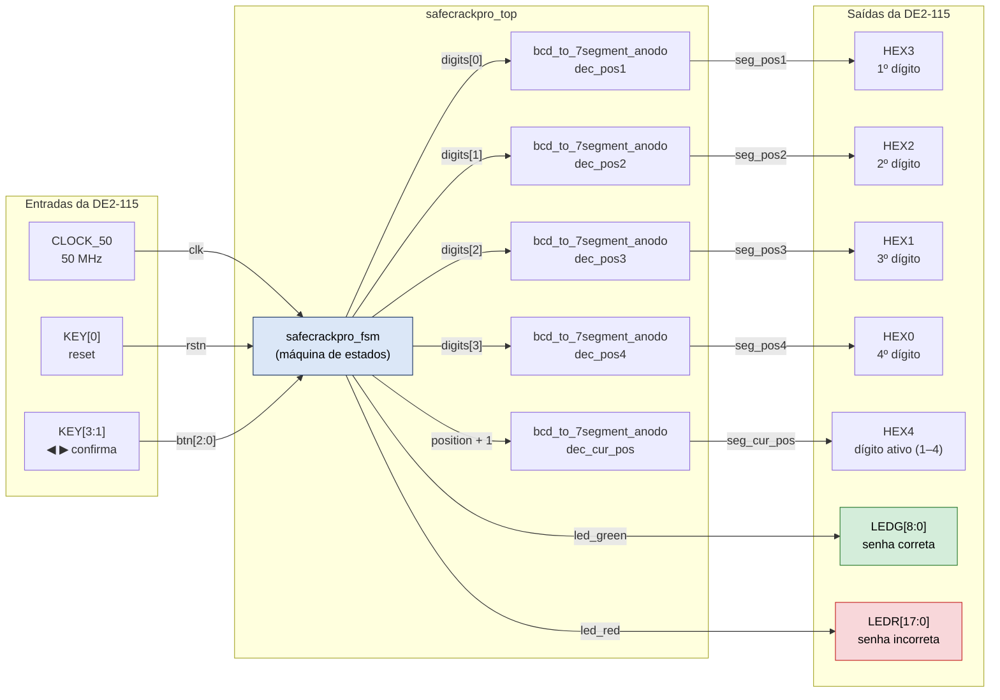
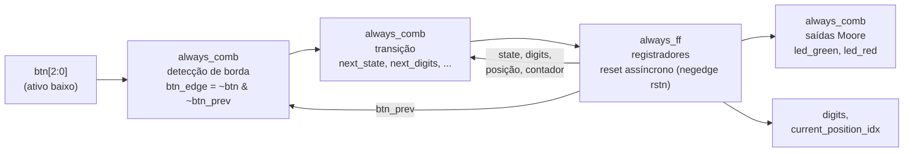
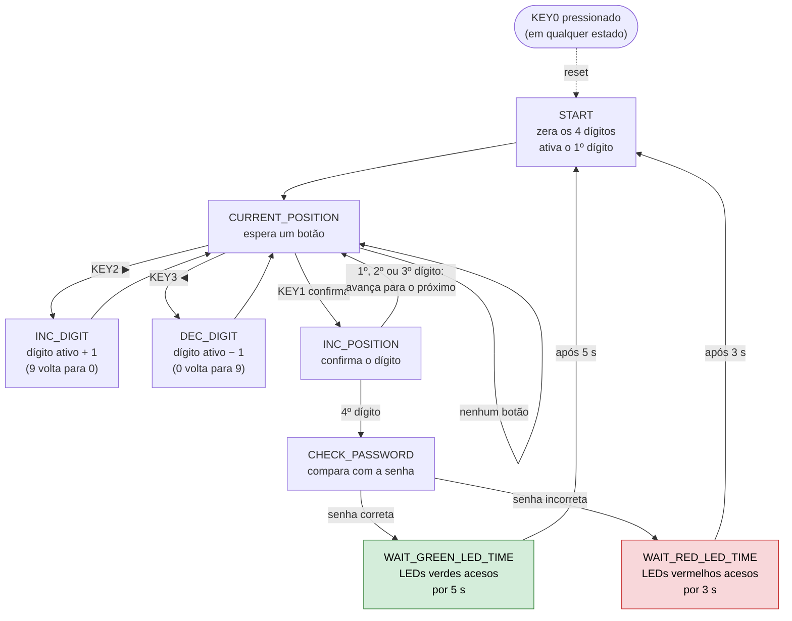
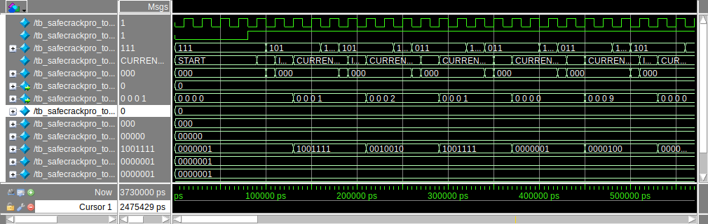
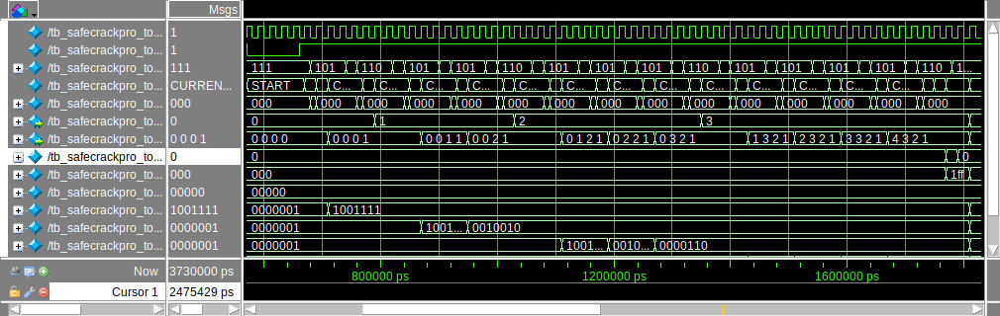
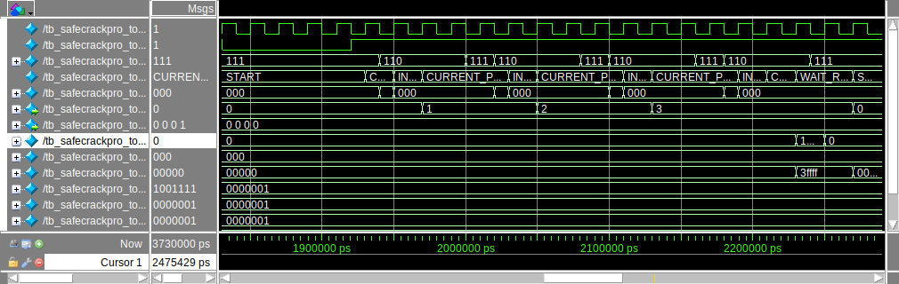

# SafeCrack Pro — cofre com seleção de dígitos por push buttons e displays de 7 segmentos

**CIN0130 – Sistemas Digitais · Projeto Final · 2026.2 · Prof. Victor Medeiros**

**Integrantes:**

- Carlos Henrique da Silva Cunha (chsc)
- Livia Clarissa Goncalves Alexandrino (lcga)
- Lucas Matheus do Carmo (lmc8)
- Maria Fernanda Soares dos Santos (mfss)
- Vinicius Luiz da Fonseca Santos (vlfs2)

---

## 1. Visão geral

O SafeCrack Pro é uma evolução do **SafeCrack FSM** visto em sala  ([snippet 4909655](https://gitlab.com/-/snippets/4909655)).
No SafeCrack original a senha era digitada diretamente: cada botão correspondia a uma entrada. Neste projeto, o usuário **compõe** uma
senha de **4 dígitos (0 a 9)**: navega pelo valor de cada dígito com os push buttons da DE2-115 e confirma um dígito por vez.
Depois do 4º dígito, o sistema verifica a senha e acende os LEDs verdes (correta, 5 s) ou vermelhos (incorreta, 3 s).

- **Senha padrão:** **1-2-3-4**. Ela é definida pelo parâmetro **PASSWORD = 16'h1234** (veja a [seção 4.5](#45-verificação-da-senha)).
- **Placa:** Terasic DE2-115 (Cyclone IV E **EP4CE115F29C7**), clock de 50 MHz.

### Interface com o usuário

| Elemento da placa | Sinal no código | Função |
|-------------------|-----------------|--------|
| **KEY[3]** | **btn[2]** | **◀ Esquerda:** decrementa o dígito ativo (0 → 9 dá a volta) |
| **KEY[2]** | **btn[1]** | **▶ Direita:** incrementa o dígito ativo (9 → 0 dá a volta) |
| **KEY[1]** | **btn[0]** | **Confirma:** fixa o dígito ativo e avança. No 4º dígito, verifica a senha |
| **KEY[0]** | **rstn**   | **Reset:** volta ao estado inicial a qualquer momento (assíncrono) |
| **HEX3** **HEX2** **HEX1** **HEX0** | **seg_pos1** … **seg_pos4** | 1º, 2º, 3º e 4º dígitos da senha |
| **HEX4** | **seg_cur_pos** | Índice do dígito ativo (**1** a **4**) |
| **LEDG[8:0]** | **led_green** | Todos acesos por 5 s quando a senha está correta |
| **LEDR[17:0]** | **led_red** | Todos acesos por 3 s quando a senha está incorreta |

Todos os **KEY** são **ativos em nível baixo**: valem **0** quando pressionados.

---

## 2. Estrutura do repositório

```
safecrackpro/
├── README.md                          # este documento
├── guia-simulaçao-compilaçao.pdf      # guia passo a passo da simulação (ModelSim) e da compilação (Quartus)
├── simulacao_modelsim/
│   ├── safecrackpro_fsm.sv            # FSM de controle (implementada pelo grupo; contém a senha PASSWORD)
│   ├── safecrackpro_top.sv            # top-level: integra a FSM e os 5 decodificadores (fornecido)
│   ├── bcd_to_7segment_anodo.sv       # decodificador BCD → 7 segmentos, ânodo comum (fornecido)
│   └── tb_safecrackpro_top.sv         # testbench do professor (44 verificações)
├── quartus/
│   ├── safecrackpro.qpf               # projeto Quartus
│   ├── safecrackpro.qsf               # device EP4CE115F29C7, arquivos .sv e pinagem
│   ├── safecrackpro.sdc               # restrição do clock de 50 MHz
│   ├── pin_assignments.txt            # pinagem da DE2-115 (fornecida)
│   └── output_files/
│       └── safecrackpro.sof           # arquivo compilado para gravar na FPGA
└── docs/
    └── waveforms/                     # waveforms exportadas do ModelSim
        ├── 01_reset_inc_dec_wrap.png
        ├── 02_tb_senha_correta.png
        └── 03_tb_senha_incorreta.png
```

Os arquivos fornecidos pelo professor vêm do [snippet 6002284](https://gitlab.com/-/snippets/6002284): o decodificador
BCD → 7 segmentos de ânodo comum (**bcd_to_7segment_anodo.sv**), o módulo top-level que integra a FSM e os decodificadores
(**safecrackpro_top.sv**) e o testbench que simula o acionamento dos botões e verifica o comportamento do sistema
(**tb_safecrackpro_top.sv**). O único arquivo desenvolvido pelo grupo é a máquina de estados que controla o cofre
(**safecrackpro_fsm.sv**), com os nomes de módulo, portas e sinais internos que o top e o testbench esperam.

---

## 3. Arquitetura



A FSM (em azul) é o módulo desenvolvido pelo grupo. Ela guarda os 4 dígitos e a posição ativa e controla os LEDs; o
top-level apenas liga suas saídas aos 5 decodificadores de 7 segmentos e aos pinos da placa.

Internamente, o código da FSM segue a mesma organização do SafeCrack base:



1. **always_comb de detecção de borda.** Converte os botões para ativo alto (**btn_pos = \~btn**) e gera
   **btn_edge = btn_pos & \~btn_prev**.
2. **always_ff (registradores).** Guarda **state**, **btn_prev**, **digits**, **current_position_idx** e **led_time_cnt**, com
   **reset assíncrono ativo baixo** (**negedge rstn**).
3. **always_comb de transição.** Calcula **next_state** e os próximos valores dos registradores. Todas as variáveis
   recebem um valor padrão no início do bloco, o que evita latches.
4. **always_comb de saída (Moore).** Os LEDs dependem **apenas do estado atual**.

Os estados usam **codificação one-hot** (**typedef enum logic [7:0]**) e o case usa **unique case**, como no material
*FSM e SystemVerilog*.

---

## 4. Como cada requisito foi implementado

### 4.1 Diagrama de estados



Como ler o diagrama:

- Cada caixa é um estado: em cima está o nome usado no código e, embaixo, o que ele faz.
- As setas mostram a condição para mudar de estado. Seta sem texto significa que a mudança acontece sozinha no
  próximo ciclo de clock. Por isso **INC_DIGIT** e **DEC_DIGIT** duram só 1 ciclo.
- Só um botão por vez é aceito. Se nenhum botão for apertado, ou se dois forem apertados juntos, a FSM continua em
  **CURRENT_POSITION**.
- O reset (**KEY[0]**) é **assíncrono**: de **qualquer** estado, a FSM vai imediatamente para **START**. Há ainda uma
  transição **default → START** no código, para recuperar a FSM caso ela caia em um estado inválido.

#### Tabela de estados

| Estado | Código one-hot | O que faz | LEDs |
|--------|----------------|-----------|------|
| **START** | **0000_0001** | Zera os 4 dígitos, seleciona o 1º dígito e vai para **CURRENT_POSITION** | apagados |
| **CURRENT_POSITION** | **0000_0010** | Espera a borda de **um** botão e decide a ação | apagados |
| **INC_DIGIT** | **0000_0100** | Soma 1 ao dígito ativo, com wrap-around 9 → 0 (dura 1 ciclo) | apagados |
| **DEC_DIGIT** | **0000_1000** | Subtrai 1 do dígito ativo, com wrap-around 0 → 9 (dura 1 ciclo) | apagados |
| **INC_POSITION** | **0001_0000** | Confirma o dígito: avança a posição ou, se for o 4º, vai verificar a senha | apagados |
| **CHECK_PASSWORD** | **0010_0000** | Compara **digits** com a senha e carrega o contador de tempo | apagados |
| **WAIT_GREEN_LED_TIME** | **0100_0000** | Conta 5 s e depois volta para **START** | **verdes acesos** |
| **WAIT_RED_LED_TIME** | **1000_0000** | Conta 3 s e depois volta para **START** | **vermelhos acesos** |

Os nomes dos estados são os mesmos citados nos comentários do testbench fornecido (**CURRENT_POSITION**, **INC_DIGIT**,
**DEC_DIGIT**, **INC_POSITION**, **CHECK_PASSWORD**, **WAIT_GREEN_LED_TIME**, **WAIT_RED_LED_TIME**).

### 4.2 Estado inicial e reset (**KEY[0]**)

- O **KEY[0]** está ligado ao pino **rstn**. O **always_ff** é sensível a **negedge rstn**, então o reset é **assíncrono**: ele
  age na hora, sem esperar o clock, e funciona em **qualquer estado**, inclusive durante o feedback dos LEDs.
- No reset, **state = START**, **digits = 0** (todos os displays mostram **0**), **current_position_idx = 0** (**HEX4** mostra
  **1**) e os LEDs ficam apagados, porque as saídas são Moore e **START** não acende nenhum LED.

### 4.3 Um pressionamento = uma ação (detecção de borda)

Usamos a mesma técnica do SafeCrack base:

```systemverilog
btn_pos  = ~btn;                // ativo baixo → ativo alto
btn_edge = btn_pos & ~btn_prev; // 1 apenas no 1º ciclo em que o botão aparece pressionado
...
btn_prev <= btn_pos;            // registrado a cada ciclo
```

Enquanto o botão continua pressionado, **btn_prev** já vale **1** e, por isso, **btn_edge** volta a **0**. A FSM só reage a
**btn_edge**, então **segurar o botão gera uma única ação**. Na waveform dos testes 1 a 5, cada pressionamento dura
3 ciclos, mas gera um único pulso de 1 ciclo em **btn_edge** e uma única mudança no dígito. Os **KEY** da DE2-115 já têm
**debounce por Schmitt Trigger**, como diz a seção 4.2 do manual da placa, então a FSM não precisa de um filtro de
debounce próprio.

Em **CURRENT_POSITION**, a FSM só aceita códigos com **exatamente um** bit ativo (**3'b001**, **3'b010** ou **3'b100**), como o
SafeCrack base faz com **btn_edge == 3'b001**. Bordas simultâneas de dois botões no mesmo ciclo são ignoradas.

### 4.4 Edição dos dígitos e navegação (**KEY[3]**, **KEY[2]**, **KEY[1]**)

- Os dígitos ficam em **logic [3:0][3:0] digits** (4 dígitos BCD de 4 bits). **digits[0]** é o 1º dígito, mostrado em
  **HEX3**, e **digits[3]** é o 4º, mostrado em **HEX0**.
- **INC_DIGIT** e **DEC_DIGIT** alteram **somente** **digits[current_position_idx]**, com wrap-around:
  ```systemverilog
  next_digits[current_position_idx] = (active_digit == 4'd9) ? 4'd0 : active_digit + 4'd1; // ▶
  next_digits[current_position_idx] = (active_digit == 4'd0) ? 4'd9 : active_digit - 4'd1; // ◀
  ```
- **INC_POSITION** só **avança**: **current_position_idx + 1**. Nenhum estado decrementa a posição, então não há como voltar
  a um dígito já confirmado. Para recomeçar, o usuário usa o reset.
- **Indicação do dígito ativo:** o top envia **position + 1** para um decodificador ligado a **HEX4**, que mostra **1**, **2**,
  **3** ou **4**.

### 4.5 Verificação da senha

A senha é o parâmetro **PASSWORD** do módulo. Cada nibble é um dígito, na ordem em que aparece nos displays:
**16'h1234** → **HEX3=1**, **HEX2=2**, **HEX1=3**, **HEX0=4**. A FSM compara cada dígito digitado com o nibble
correspondente da senha, e **CHECK_PASSWORD** usa o resultado:

```systemverilog
assign password_ok = (digits[0] == PASSWORD[15:12]) &&
                     (digits[1] == PASSWORD[11:8])  &&
                     (digits[2] == PASSWORD[7:4])   &&
                     (digits[3] == PASSWORD[3:0]);
...
if (password_ok) → WAIT_GREEN_LED_TIME   else → WAIT_RED_LED_TIME
```

Para trocar a senha, mude o valor padrão de **PASSWORD** no **safecrackpro_fsm.sv**. Por exemplo, **16'h2580** corresponde
à senha **2-5-8-0**.

### 4.6 Feedback temporizado (5 s verde / 3 s vermelho)

- O contador **led_time_cnt** é decrescente. Em **CHECK_PASSWORD** ele recebe **GREEN_LED_CYCLES − 1** ou
  **RED_LED_CYCLES − 1**, com **GREEN_LED_CYCLES = 5 × 50 000 000** e **RED_LED_CYCLES = 3 × 50 000 000** a 50 MHz.
- Nos estados **WAIT_\***, o contador desce até **0**, o que dá **exatamente N ciclos**: 250 000 000 ciclos = 5 s e
  150 000 000 ciclos = 3 s. A largura do contador é **$clog2(GREEN_LED_CYCLES)** = 28 bits, a mesma técnica do
  **delay_cnt** do SafeCrack base.
- **led_green = 9'h1FF** (os 9 verdes) somente em **WAIT_GREEN_LED_TIME**, e **led_red = 18'h3FFFF** (os 18 vermelhos)
  somente em **WAIT_RED_LED_TIME**.
- Durante o feedback, os displays **continuam mostrando a senha digitada** e os botões de edição são ignorados.
- Quando o contador chega a 0, a FSM zera os dígitos e a posição e vai para **START**. Os displays voltam a **0** e o 1º
  dígito fica ativo, pronto para uma nova tentativa.
- O contador foi feito decrescente justamente para funcionar com a tarefa **skip_led_wait()** do testbench fornecido,
  que força **led_time_cnt = 0** para pular a espera.

---

## 5. Simulação e compilação

O passo a passo completo que seguimos, com os comandos executados e capturas de tela, está no
**[Guia de Simulação (ModelSim) e Compilação (Quartus)](guia-simula%C3%A7ao-compila%C3%A7ao.pdf)** deste repositório. Em resumo:

- **Simulação (ModelSim Intel FPGA Starter Edition 20.1):** o testbench do professor terminou com
  **44 / 44 testes aprovados**, cobrindo reset, incremento, decremento, wrap-around 0↔9, senha correta 1-2-3-4,
  senha incorreta 0-0-0-0, independência dos dígitos e estabilidade sem botão. Para não simular 250 milhões de
  ciclos, o testbench pula a espera dos LEDs com a tarefa **skip_led_wait()**; na placa valem os tempos reais.
- **Compilação (Quartus Prime Lite 25.1):** *Full Compilation* concluída com **0 erros**, usando 152 elementos
  lógicos (< 1% do chip) e 67 pinos, com todos os slacks de tempo positivos a 50 MHz. O arquivo para a placa é
  [**quartus/output_files/safecrackpro.sof**](quartus/output_files/safecrackpro.sof).

---

## 6. Diagramas de tempo (waveforms)

As imagens foram exportadas do ModelSim e estão em [**docs/waveforms/**](docs/waveforms/). Cada uma mostra o intervalo
de tempo de um cenário do testbench:

| Cenário | Intervalo | Arquivo |
|---------|-----------|---------|
| Testes 1–5: reset, incremento, decremento e wrap-around | 0 – 570 ns | **01_reset_inc_dec_wrap.png** |
| Teste 6: senha correta 1-2-3-4 | 570 – 1830 ns | **02_tb_senha_correta.png** |
| Teste 7: senha incorreta 0-0-0-0 | 1830 – 2290 ns | **03_tb_senha_incorreta.png** |

**Como ler as imagens.**

- Os sinais aparecem de cima para baixo nesta ordem: **clk**, **rstn**, **btn**, **state**, **btn_edge**,
  **current_position_idx**, **digits**, **led_time_cnt**, **led_green**, **led_red**, **seg_pos1**, **seg_pos2** e **seg_pos3**.
- Os botões são ativos em nível baixo: **btn = 111** (nenhum), **101** (**KEY[2]**, incrementa), **011** (**KEY[3]**,
  decrementa) e **110** (**KEY[1]**, confirma).
- O sinal **digits** mostra o 4º dígito à esquerda. Por isso a senha 1-2-3-4 aparece como **4321**.

**Testes 1–5: reset, incremento, decremento e wrap-around.**
Após o reset, todos os dígitos estão em 0. Dois toques em **KEY[2]** levam o 1º dígito a 1 e depois a 2. Três toques em
**KEY[3]** o levam a 1, 0 e 9 (wrap-around). Um último toque em **KEY[2]** volta de 9 para 0. Cada toque gera uma única
mudança, e o display **seg_pos1** acompanha o valor.



**Teste 6: senha correta 1-2-3-4.**
Cada dígito é ajustado com **KEY[2]** e confirmado com **KEY[1]**. A posição ativa avança de 0 a 3, e **digits** chega a
**4321** (senha 1-2-3-4). Na 4ª confirmação, a FSM verifica a senha e **led_green** vai para **1ff** (os 9 LEDs verdes
acesos). O testbench pula a espera de 5 s e o sistema volta ao início.



**Teste 7: senha incorreta 0-0-0-0.**
Quatro confirmações seguidas, sem alterar os dígitos, enviam a senha 0-0-0-0. Na verificação, a FSM vai para
**WAIT_RED_LED_TIME** e **led_red** vai para **3ffff** (os 18 LEDs vermelhos acesos). Depois da espera, o sistema volta ao
início.



---

## 7. Known issues (limitações conhecidas)

1. **Dois botões ao mesmo tempo.** Se dois botões forem apertados exatamente no mesmo instante, o sistema ignora os
   dois. Se um botão já estiver sendo segurado e o outro for apertado depois, o segundo funciona normalmente.
2. **Botões durante os LEDs.** Enquanto os LEDs estão acesos (5 s no verde ou 3 s no vermelho), os botões não fazem
   nada. Só o reset funciona. Se o usuário continuar segurando um botão quando o sistema voltar ao início, precisa
   soltar e apertar de novo, o que não necessariamente é um erro, mas uma observação.
3. **Senha inválida no código.** Cada dígito da senha (**PASSWORD**) deve ficar entre 0 e 9. Se for usado um valor
   maior, como **16'h12A4**, a senha não poderá ser digitada na placa. O código não faz essa verificação.
4. **HEX4 durante os LEDs.** Enquanto os LEDs estão acesos, o HEX4 continua mostrando **4**, o último dígito editado.
